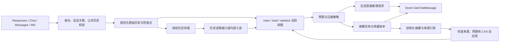

# Devin CLI compactor 分析与 Sub2API 平台迁移设计

状态：公共压缩核心与 Fusion 适配已完成专项回归；普通托管会话与新接口仍为设计。核查日期：2026-10-23。代码基线：`d67081182`。最新 CLI 二进制分析仍受下载访问限制。

建议将当前 Fusion 压缩器提取为可复用的上下文管理组件，保留 Lead / Sidekick 的角色隔离，再为普通 Devin 模型增加显式启用的托管会话。平台需要一起解决摘要、原始历史存储、历史读取、客户端续接和计费恢复；仅增加一个摘要提示词不能提供完整的长会话能力。

实施范围、存储选型、接口合同和 PR 顺序已收敛到 [实施方案 v1](DEVIN_COMPACTION_IMPLEMENTATION_PLAN.md)。本文保留机制证据与后续设计方向，具体首版交付以实施方案为准。

## 1. 证据及版本边界

| 来源 | 本次能够支持的结论 | 限制 |
| --- | --- | --- |
| [官方命令文档](https://docs.devin.ai/cli/reference/commands)、[更新记录](https://docs.devin.ai/cli/changelog/stable)、[hook 文档](https://docs.devin.ai/cli/extensibility/hooks/lifecycle-hooks) | 手动 `/compact`、自动压缩、配置阈值、摘要完成事件、压缩前后会话恢复行为 | 未公开完整 compactor 实现 |
| [官方 Fusion 介绍](https://cognition.com/blog/local-fusion) | Lead / Sidekick 各自拥有持久上下文，通过 brief、报告和反馈协作 | 不给出两角色压缩的全部内部调度规则 |
| [devin2api 的原始分析报告](https://github.com/WncFht/devin2api/blob/e8547b6d60cb09fddc6debe44bafdfa69867a963/docs/upstream-compaction.md) | `3000.10.21` 二进制字符串及协议分析记录：三阈值、异步任务、摘要模型 override/fallback、历史文件和保留项 | 本次读到了报告，未独立取得或反编译该二进制；字符串不能证明每个运行分支均被启用 |
| [该版本提取的协议](https://github.com/WncFht/devin2api/blob/e8547b6d60cb09fddc6debe44bafdfa69867a963/outputs/devin-proto/all-protos.proto#L2007)、[协议探测记录](https://github.com/WncFht/devin2api/blob/e8547b6d60cb09fddc6debe44bafdfa69867a963/docs/upstream-protocol.md) | 本次直接检查了 `GetChatMessageRequest` 字段：携带历史、模型、工具与生成配置，没有专用 compact 字段；探测记录报告 cascade ID 不代存对话 | 不能仅凭字段缺失推导整个 Devin 云服务没有压缩能力 |
| 本仓库 [DEVIN_FUSION.md](DEVIN_FUSION.md) | 引用 `3000.11.92` 静态报告，称 `file_compactor.compact` 使用共用推理构造器 | 引用的完整报告与二进制不在当前工作区，本次没有独立复核 |
| [最新稳定版更新记录](https://docs.devin.ai/cli/changelog/stable)、[Homebrew cask](https://github.com/Homebrew/homebrew-cask/blob/main/Casks/d/devin-cli.rb) | 两处均记录 `3000.11.205`；官方发布日期为 2026-10-22 | 确认了版本及公开行为；尚未取得该版本二进制，不证明旧版内部常量保持不变 |
| 当前 Sub2API 源码及本次运行的 Fusion 专项测试 | 网关实现与已覆盖的状态机行为 | 模拟 provider 测试不证明真实上游、最新 CLI 或摘要语义质量 |

下文把官方公开行为、版本限定的静态记录和平台设计建议分开陈述。当前环境未安装 Devin CLI，也没有可用于本次核验的真实 Devin 账号流量；不将未执行的抓包或二进制分析称为已验证。

### 1.1 本轮 REA 工作的实际状态

已从官方 npm 包安装 `rea-agents@6.7.0`，读取其 `reverse-engineer-anything` 技能，并在独立工作台启动过 REA stdio MCP：服务端返回版本 `6.7.0`、207 个工具。已安装并校验 Ghidra `12.1.4`、Temurin JDK `21.0.13+9`；`rea doctor --provider ghidra --json` 返回 `healthy: true`。这证明工具链准备完成，尚不证明针对 Devin 的导入、反编译或运行探测成功。

官方 `https://static.devin.ai/cli/current/manifest.json` 的实际访问返回 HTTP 403，该域名不在当前执行环境的网络允许列表中。已请求放行下载域名或提供本地 CLI 路径；未通过其他镜像绕过限制。选定的公开稳定版目标为：

```text
build: 3000.11.205
platform: x86_64-unknown-linux
archive: https://static.devin.ai/cli/3000.11.205/devin-3000.11.205-x86_64-unknown-linux.tar.gz
expected archive SHA-256: 2e65c8b93682258fc91f5e4cead92e3698338cebf1b31dbc32a3201cb63705c4
source: Homebrew Casks/d/devin-cli.rb, blob 76f5f5705bd5be9087e3976681d7ac144084da92
actual archive SHA-256: 尚未取得
actual bin/devin SHA-256: 尚未取得
```

压缩包 hash 不能当成可执行文件 hash；官方 current manifest 恢复可读后还需再次核对最新 build。旧 `3000.11.92` 引用是 macOS arm64，不能把其函数地址直接用于 Linux x64。跨平台静态差异也不能全部归因于版本变化。

## 2. CLI 的机制

### 2.1 由客户端 agent 管理上下文

对于这里使用的 `GetChatMessage` 路径，调用方构造完整输入历史。选择 Devin 承载的某个模型，不会使代理自动获得 CLI 的会话管理逻辑。CLI 的普通模式管理一条主链；Fusion 管理相互独立的角色上下文。

协议文件还存在 Cascade planner 的 summarizer 配置、轨迹摘要类型和扩展服务的更新 RPC。它们属于不同的 agent/IDE 路径，不能直接作为当前聊天适配器的 compact 接口。

### 2.2 触发、准备、应用是不同阶段

`3000.10.21` 分析报告记录了 `SPAWN,[APPLY,]HARD` 阈值，以及 Sidekick 的独立阈值入口。其设计含义是：到 spawn 提前准备摘要；到 apply 且摘要就绪时替换上下文；到 hard 阻止下一次普通推理继续，等待压缩。双值形式表示 apply 与 hard 相同。

这些属于该版本的静态证据。报告里的 `183500,183500,262144` 是观察到的组合，不应当写成所有模型通用默认值。官方更新记录确认可通过 `agent.compaction_threshold_tokens` 提前自动压缩，但未完整说明它与上述内部入口在最新版本中的优先级。

从平台角度，后台任务应摘要固定前缀，前台可以继续追加后缀。实际应用必须在安全边界检查前缀仍相同，防止后台结果覆盖用户刚补充的内容。Sub2API 当前已实现这类校验，不能仅凭 CLI 字符串推定官方使用完全相同的并发算法。

### 2.3 摘要生成与摘要模型选择

版本分析报告记录了独立的摘要调用、流建立重试，以及指定摘要模型失败后回落的分支。摘要内容围绕任务目标、关键发现和来源线索、当前进度与待办组织；摘要任务不执行原始对话里的操作。

因此不能断言官方始终用当前模型、始终用 Sidekick，或存在可直接调用的固定 `compactor` UID。日志中的用途标签、展示名称和上游模型 UID 必须分别验证。Sub2API 目前是由本角色模型生成摘要，属于网关自己的已实现策略。

### 2.4 摘要与可回查历史共同支持恢复

版本报告记录了 `file_compactor` / `async_file_compactor`、落盘历史文件、摘要中的历史线索，以及编辑文件、todo 和交接信息的保留机制。它还记录了消息来源和压缩前 token 数的元数据。

这一设计适合 CLI：agent 有本地工具，可以按线索回查历史。网关只有归档 ID 而没有可供模型使用的读取渠道时，不能声称提供了同等恢复能力。

### 2.5 规则重新加载依赖 CLI 的本地能力

版本报告中的摘要策略会省略可重新发现的规则，另有需要跨压缩保留的标记。官方更新记录也提到压缩后重新发现 skills 的修复。

Sub2API 看不到客户端工作区，也不能保证其重新注入规则。因此迁移时应保留 system/developer 原文和来源，保留用户的当前目标及明确约束；只有客户端明确提供了可重载合同和版本信息，才允许移出活动上下文。摘要本身不获得更高的指令优先级。

### 2.6 最新稳定版带来的迁移约束

`3000.11.205` 的官方记录确认：steering 会立即中断当前 agent 工作并保留长命令进度；工具完成 hook 可以替换模型将看到的工具输出；会话存储增加实验性的文件后端。`3000.11.92` 已记录手动/自动 compaction hooks。它们对压缩的具体内部交互仍需逆向验证。

平台因此需要明确中断与会话终止的区别，保存模型实际可见的工具结果版本，并将会话存储接口与摘要文件分开。不能从“增加文件存储后端”推断新版替换了 `file_compactor`，也不能从通用 hook 能结束 turn 推断它必然控制压缩提交。

## 3. 当前 Sub2API 的基础与缺口

| 能力 | 当前证据 | 迁移处理 |
| --- | --- | --- |
| 三阶段异步压缩 | `fusion/maintenance.go`、`compaction.go:prepareRoleContext` | 复用；手动与自动调用统一状态机 |
| 双角色隔离 | `types.go:Session.Contexts`、`LaneScope` | 复用；普通模型增加 `main` lane，不伪装成 Fusion |
| 固定前缀校验、CAS 与原文归档 | `applyCompaction` 检查 epoch、profile、digest、切分点 | 复用并增加稳定消息引用 |
| 工具配对与活动交接保留 | `safeSummaryPrefix`、`protectedPrefix` | 复用；按完整执行组和 token 预算选择尾部 |
| 独立摘要 attempt、预留与补账 | `performCompaction`、`collectCompactions`、`devinFusionExecutor.Settle` | 提取公共执行器，维持 unknown 不盲目重发 |
| 普通 Devin 请求 | `openai_gateway_devin.go`、`devin/request.go` 全历史转发 | 缺少通用托管会话与自动 compactor |
| 历史读取 | 当前只有 TTL 归档和 digest，没有提供给角色的归档读取工具 | 增加授权读取合同，再引入可回查摘要 |
| 客户端 compact | `openai_gateway_forward.go` 对 Devin `/responses/compact` 返回 404；`request.go` 不接受 compact item | 独立设计下游协议，不能只移除拒绝分支 |
| 公共历史续接 | `contract.go:delta` 校验已有公共历史或显式增量关联 | 增加明确的 public checkpoint/rebase 合同 |

需要优先处理的四个容量问题：

1. **估算单位混用。** `MeasureContext` 用序列化字节数作为保守 token 数，与模型窗口比较；客户端 `count_tokens` 又使用本地 tokenizer 估算。两者不是相同口径，可能导致客户端认为还有空间而网关已到 hard gate。非文本输入也需要独立计量策略。
2. **固定尾部不是预算。** 当前至少留最后六个 input item；一个很大的最新工具结果就可能占满窗口。应按完整执行组和可用预算保留尾部；无法缩减的当前输入明确失败，不能拆断工具配对。
3. **被保护内容仍会增长。** Lead 会保留所有非摘要的 user 消息。不能为了长会话直接删除这些消息中的约束；后续需要带来源、可覆盖关系的任务状态，或调用方明确标注哪些内容必须保留。
4. **会话存储继续增长。** `Session.Public`、`Attempts`、`Requests` 等仍留在同一个 JSON 中；`store.go:save` 在 12 MiB 处拒绝。角色压缩不会消除这项上限。摘要前缀归档还另有累计 12 MiB 限额。

## 4. 平台架构



### 4.1 原始历史、活动视图和公共续接分别保存

- **原始历史**：追加保存规范化消息，分配稳定 message ID；原文按块存储，供回查、审计、重放和分叉使用。归档和消息数据按租户/API key 作用域隔离，有限保留期与存储额度。
- **活动视图**：每条 lane 保存摘要引用、受保护消息、当前交接与近期完整执行组；推理只使用这个视图。压缩成功增加该 lane 的 context epoch。
- **公共续接**：保存客户端可见消息、响应和工具的关联及检查点；角色内部压缩不改变公共历史的语义和工具归属。

实施方案为新 v2 会话选择 PostgreSQL 统一保存 CAS 元数据、执行租约、历史块、大响应和 attempt；Redis 继续承载现有并发/额度机制。旧 Fusion 会话保持原 Redis 格式。写历史块与提交引用使用同一事务；以后接入对象存储时，需要先写块、再提交引用并清理孤立块，不能先提交指向尚未保存内容的检查点。幂等响应、attempt 结果与账务保留期单独明确，避免清理归档破坏重试。

普通模型的 HTTP、Chat、Messages 和 WS 共用同一套规范化与关联规则。连接 ID 本身不能授权跨连接恢复；客户端传来的 session ID 也必须在当前身份作用域内校验。

### 4.2 通用组件职责

建议新建 `backend/internal/pkg/contextcompact/`，将策略和数据模型与 Fusion 编排解耦：

| 组件 | 输入与职责 |
| --- | --- |
| `BudgetEstimator` | 真实模型、最终 provider 请求形状、输出预留 → 估算 token 数、误差余量、字节数与估算方法 |
| `PrefixPlanner` | lane、受保护项、未完成工具组 → 可摘要前缀与完整尾部 |
| `SummaryGenerator` | 前缀快照、摘要策略、被授权的具体模型 → 结构化摘要；复用 Devin 请求与账务执行器 |
| `ArtifactStore` | 摘要、来源消息 ID/digest、模型与策略版本、状态和保留期 |
| `ApplyGuard` | 验证会话、lane epoch、来源、工具合同、预算；CAS 切换视图 |
| `MaintenanceRunner` | 有界后台任务、前台容量优先、取消；恢复已知结果，不自动重发未知调用 |

数据至少包含：身份作用域、session ID、lane、原账号/具体模型、policy revision、context epoch、来源起止 ID/digest、摘要正文、受保护项引用、attempt ID、费用状态、有效期。摘要中声明的引用必须由服务端校验确实属于该前缀。

建议在公共核心中显式定义 `SnapshotToken{session_branch, lane_epoch, source_end_id, source_digest, tool_contract_revision, visibility_policy_revision, model_revision, summary_policy_revision}`。后台摘要绑定这个快照；前台追加后缀允许发生，回退、分叉、来源改写或策略变更使旧快照失效。账务状态与摘要是否采用分别记录，不能用一个 `done` 同时表示生成完成、成功应用和费用结清。

摘要不能创造工具结果。文件清单和 todo 只有来自已识别工具合同及实际结果时，才能作为结构化事实；任意工具名称或 LLM 生成的文件列表不应当被平台自动当成已完成修改。

### 4.3 预算单位与阈值

建议明确分开三项：

```text
safe_input_tokens = concrete_context_window - reserved_output_tokens - estimation_margin
estimated_input_tokens = estimate(final_provider_request)
max_wire_bytes / max_stored_bytes = 独立的传输与存储上限
```

模型窗口取自账号实际目录；普通 router 必须在解析具体模型后检查。首版托管普通模型可只支持明确具体模型，router 等有真实模型切换合同后再接入。

优先使用已验证 tokenizer/计数能力；其他模型按最终 wire 形状估算，并根据真实 usage 校准误差。缓存命中 token 仍占上下文窗口，不能从窗口计数中扣除。校准需确认 usage 口径，不能把本地 tiktoken 当作所有厂商的精确 tokenizer。无法安全计量的多模态输入保留保守限制或明确拒绝。

现有 `lead_thresholds` / `sidekick_thresholds` 的单位是保守字节估算量。迁移必须保留旧 policy 的解释，新 token 策略使用明确版本和单位；不能直接把历史配置当 token 数读取。

可以先保留当前 60% / 75% / 90% 作为网关策略起点，灰度后按模型调整。它们是本平台默认策略，不标注为官方默认值。摘要完成后应重新估算最终请求并满足收缩目标；到 hard 仍无法容纳则返回 413，给出是固定指令、工具声明、当前输入还是历史无法缩减。

### 4.4 摘要模型、失败与计费

先保留 same-role 策略，后续允许管理员为 main/lead/sidekick 指定独立摘要模型。指定模型必须经过账号授权、能力、上下文窗口和定价校验；不能只按名称猜测 `compactor` 可用。

所有摘要走 `purpose=compaction` 的独立 attempt，保留来源请求/turn/session 关联。失败回落必须重新校验预算并产生新的 attempt；上游结果不明时先恢复结果或账务，不做不受限的重发。摘要完成但未采用、过期或被取消，已经发生的实际费用仍需结算。

提供 session 级的正常推理与 maintenance 用量明细。后台费用可能在原 HTTP 响应结束后产生，不能事后把它伪装为该响应已经报告的 usage。短期沿用独立 usage log；后续增加可查询的会话累计 maintenance 用量。

### 4.5 历史可读取性

首版可以返回普通摘要和完整受保护上下文，并提供给客户端使用的授权历史读取 API。该模式只有客户端调用读取 API 并回传内容时，模型才能恢复原文，不能在提示词里承诺模型可打开一个不存在的本地文件。

要达到 CLI 的自主回查能力，可在 Fusion 和显式托管模式中增加平台内部 `history_search` / `history_read` 工具：

- 仅访问当前 scope/session/lane 被授权的历史；Lead 不自动获得 Sidekick 私有历史。
- 工具名保留并检查冲突，由网关执行和闭合 call/result；不发布给客户端执行。
- 必须在 session 创建时声明为固定工具合同的一部分；不能压缩后临时改变现有工具合同。
- 读取有次数、字节和 token 上限；结果是历史数据，不能升级为 system 指令。
- 内部工具后的追加模型调用计入普通推理预算；压缩再次触发时仍遵守同一限制，避免循环读取、压缩。

当前网关普通转发只处理一次上游生成；加入内部历史工具就需要有界推理循环。应只在显式托管模式启用，不悄悄改变普通透传请求的工具执行方式。

### 4.6 中断、取消与并发应用

以下是平台合同，不是对未分析新版 CLI 的实现描述：

| 事件 | 摘要任务处理 | 后续推理 |
| --- | --- | --- |
| 用户仅追加消息 | 固定前缀未变时允许继续生成；新内容留在尾部 | 在下一安全边界重算预算 |
| steering 中断当前生成 | 取消该 inference attempt；保持合法摘要快照，按会话策略决定是否继续后台生成 | 收齐仍有效的工具结果，再以新输入恢复；禁止构造虚假完成结果 |
| 明确停止会话 | 停止新任务并禁止摘要应用；迟到结果只恢复已发生费用 | 需要显式恢复/新分支才允许继续 |
| 回退、分叉、工具或可见性规则变更 | 旧快照标记 stale；不再提交 | 使用新 branch/revision 重建视图 |
| 已发出上游请求但结果未知 | 标记 uncertain，保留 attempt 与额度预留 | 按恢复合同处理，不把取消等同于免费或未执行 |

当前 Fusion 的 `Cancel` / `Session.State=Cancelled` 是会话停止语义，现有测试还要求迟到摘要只结算、不应用。迁移时保留此行为；如果增加 steering，应新增 turn/attempt 级中断事件，不能直接复用终止会话接口。

推荐状态链为 `prepared → running → ready → applied`；另有 `failed / stale / cancelled / uncertain`。`ready` 只说明摘要生成并通过格式验证；应用前仍检查快照、pending tools、受保护内容、最终大小与 CAS。公开 checkpoint 的接受也执行这些检查。长模型调用使用可恢复的 lane 执行租约与 fencing token，防止租约过期后的旧执行者提交；事务锁只覆盖短暂提交。不能仅缩短现有会话锁就允许同一 lane 并发运行两个前台 turn。

### 4.7 工具结果的版本与历史可见性

若平台或客户端支持工具输出替换、截断、脱敏，应把模型实际看到的版本作为摘要和模型回查的统一来源。规范化消息增加 `content_revision` 与 `visibility_policy_revision`，digest 在处理完成后计算。未经处理的原始结果若另作审计存储，只能通过对应授权读取，不能让 `history_read` 自动返回。

对普通转发客户端，网关只能以收到的内容为准，不能假定掌握了客户端 hook 执行前的原文。平台执行的处理规则变化时，应检查已缓存摘要和历史索引的有效性：摘要已含有后来禁止返回的内容时，仅更新历史读取权限不够，相关摘要必须失效或重建。

### 4.8 生命周期事件与可观测性

提供 `compaction.started / generated / applied / discarded / failed` 等有明确含义的内部事件，携带 session、lane、job、trigger（manual/auto/hard）、source revision、采用前后大小及估算方法；结果不明作为独立错误状态。事件不得把 `generated` 当成 `applied`。用户可查任务状态，无需在普通回答中插入摘要过程。

只用于通知和统计的订阅失败不撤销已提交视图。若以后允许扩展阻止压缩，应使用显式、有界超时的提交前校验接口；来源校验、工具配对、预算和授权检查始终由核心执行。事件写入与视图提交使用事务/outbox 或等价恢复机制，以 job/event ID 去重，避免恢复后重复通知或扣费。

## 5. 三种接入方式与接口建议

以下接口名称与字段为新设计示例，当前代码没有实现。

### 5.1 保留客户端管理模式

默认普通模型继续由客户端携带完整历史并决定 compact。平台提供准确的模型窗口说明、估算能力及明确的超限错误；客户端发送普通摘要请求时正常执行。

不会依据提示词里出现“summary”或“compact”来识别控制操作。已具备压缩能力的客户端，只有显式选择平台托管后，才启用平台自动压缩，避免不透明的重复压缩和额外费用。

### 5.2 提供显式的手动 compact

建议新增独立的 `POST /v1/context/compact`，支持无状态输入整理和托管会话操作，输出普通可回放消息和平台 artifact/checkpoint。首版无状态调用同步完成、有界超时；托管调用也可返回 job 状态供查询。对没有可压缩前缀的输入返回明确 no-op，不额外调用模型。

无状态请求示例：

```json
{
  "model": "<账号授权的具体模型 UID>",
  "input": [{"type": "message", "role": "user", "content": "<对话内容示意>"}],
  "target_input_tokens": 24000
}
```

输出语义：整理后的 `input`、`artifact_id`、估算前后大小与方法、实际 summary usage，以及是否应用。`input` 包含原角色的受保护消息、标为历史数据的摘要和完整尾部；不把普通摘要包装成 OpenAI 官方加密 compaction item。

托管调用必须提供 session、expected revision 和幂等键，区分：

| scope | 作用 |
| --- | --- |
| `internal` | 压缩所选 main/lead/sidekick 的活动视图；公共历史检查点不变 |
| `public` | 整理客户端可见历史，生成新的公共续接检查点；不泄漏或替换角色私有历史 |

`public` compact 采用准备/接受两步：准备返回整理后的历史与 opaque checkpoint；客户端下一次请求携带该 checkpoint，平台验证来源 revision/digest/工具合同后原子接受新公共视图。期间历史发生修改则拒绝该 checkpoint；未完成的客户端工具调用存在时不允许 public rebase。客户端提前放弃不会直接改变原会话，已生成摘要的费用仍独立记录。

checkpoint 是当前身份作用域内的服务端记录引用，绑定 session、来源、策略、有效期和幂等接受结果。未知、跨用户、跨 key、过期、分叉和被改写的 checkpoint 明确拒绝；不能接受一个无验证的客户端摘要替换任意已有历史。

### 5.3 普通模型的托管会话

建议通过明确配置或请求声明选择 `managed`，首次创建稳定 session，后续传 session/checkpoint/previous-response 关联；与现有 Fusion 的身份边界一致。

网关为普通模型维护 `main` 活跃视图，使用同一 compactor 自动准备和应用摘要。接收全历史时，验证与公共检查点匹配并只追加增量；接收增量时验证 lineage。客户端自行改写历史需要新会话或明确 rebase，不使用 prompt hash 或 `prompt_cache_key` 合并独立会话。

托管会话第一版固定原账号和具体模型。账号不可用时停止新推理，保留已知费用恢复；模型切换和账号迁移要建立明确的新 epoch/branch，不能带着不兼容签名或旧摘要任务直接重放。

### 5.4 Codex / Responses compact 兼容单独实施

旧 `/responses/compact` 与 `remote_compaction_v2` 是不同的下游协议合同。后者在普通 Responses 上发送 `compaction_trigger` 并期待特定流事件。当前 Devin 输入构造器不会处理这些 item。

实现需要核对指定客户端版本的请求、返回对象、压缩项后续回放、usage、流式错误与重试。若使用平台自定义 opaque compact artifact，只有本平台能够解析，必须验证客户端确实按不透明数据回传；不能宣称它是 OpenAI 生成的加密内容或可跨 provider 使用。

建议先完成平台 compact 和 checkpoint，再添加版本化兼容适配器并跑真实客户端端到端测试。完成前保留明确 unsupported 行为，避免把一次普通回答误报为成功 compact。

## 6. 分批实施与验收

| 批次 | 主要改动 | 可验收结果 |
| --- | --- | --- |
| A：抽取公共核心 | 新增 `contextcompact`；Fusion 通过适配器调用；定义快照、预算单位、任务/账务状态，旧 profile/状态继续可读 | 现有保护、CAS、取消、计费与双角色测试全部保持通过 |
| B：存储与回查 | 原始历史/大响应分块；轻量 session 元数据；稳定 message ID 与授权读取 | 多次压缩后原文可找回；超出旧单 JSON 尺寸的会话仍按新额度工作；断写不产生无效引用 |
| C：普通托管模式 | `main` lane、规范化公共历史、固定账号/模型、HTTP/WS 统一关联 | 无客户端 compact 的普通模型长工具任务能够多次压缩后完成，工具归属与 usage 正确 |
| D：手动 compact 与 public rebase | 新接口、checkpoint 准备/接受、状态与用量查询 | 客户端缩短本地历史后继续同一托管/Fusion 会话；重试不重复摘要/应用/扣费 |
| E：模型与客户端优化 | 摘要模型 override、token 估算校准、特定客户端 compact 适配 | 按模型与客户端版本验证质量、总费用与压缩等待时间，再扩大灰度 |

这些是实施顺序建议，不是已交付功能。每批独立开关；已有会话固定策略版本，优先将新策略用于新会话。停用自动压缩仍保留容量检查；不能通过关闭开关继续发送超限输入。

直接实施时的代码落点：

| 落点 | 首个可审查改动 |
| --- | --- |
| `pkg/contextcompact`（新增） | 定义快照、预算结果、前缀规划和摘要生命周期接口；不依赖 Fusion 的 Lead/Sidekick 枚举 |
| `pkg/devin/fusion/compaction.go`、`maintenance.go` | 通过适配器保留现有提示词/策略版本、60/75/90 阈值解释、角色隔离和 durable attempt；首先保证行为等价 |
| `pkg/devin/fusion/types.go`、`store.go` | 新建带 schema version 的分块会话格式；先只用于新会话，旧格式保留读取与结束路径；元数据 CAS 引用已写好的历史块 |
| `service/openai_gateway_devin_fusion.go` | 抽出具体模型预算、摘要执行和费用结算适配器；继续使用实际模型定价，禁止把摘要包装成免费维护 |
| 普通 Devin handler/service 与请求构造器 | 增加显式 managed 分流，复用公共核心维护 main lane；原转发模式继续走现有构造路径 |
| compact handler/checkpoint store（新增） | 实现幂等 compact、准备/接受、授权读取和状态查询；完成后再接 Codex 协议适配 |

路径以 `backend/internal/` 为前缀。A/B 阶段就定义预算方法和单位版本，C 阶段以前具备正确容量检查；E 的 tokenizer 校准是优化，不能把混用字节/token 的修正推迟到普通托管模式上线之后。回滚时将新会话恢复到旧路径，已有新格式会话交给仍支持该 schema 的执行器排空，不能让旧版代码直接读取新格式。

必要验收场景：

- 中英文、代码、图片、巨大工具结果和大量工具声明；固定部分超限时不做无效付费循环。
- main、Lead、Sidekick 独立压缩；一边应用摘要不使另一边的合法摘要或上下文失效。
- 摘要准备期间追加消息、取消、回退、分叉、改变工具合同、切换模型；应用前均校验来源与版本。
- steering 只取消当前推理，不误终止会话；并发运行的工具未结束时不应用会拆断执行组的摘要。明确停止会话后迟到摘要仍只结算。
- 工具结果替换后，摘要、搜索索引和 `history_read` 返回同一可见版本；后续规则收紧时旧摘要失效。
- 工具 call/result 与签名回放保持合法；未完成调用不进入有损前缀。
- 客户端三协议及 WS 重连、public compact 后续接、重复提交、幂等结果、跨身份 artifact 拒绝。
- 摘要不缩小、输出非法、虚构引用、摘要超时、provider 结果未知、结算失败、进程重启与归档部分写入。
- 反复压缩后仍能回答早期约束和测试证据，并通过授权回查找到对应原文；模拟摘要测试之外，另做真实模型质量评估。
- 统计含摘要费用和缓存重建成本的任务总费用、成功率、压缩等待时间、摘要采用率、陈旧率及估算误差；不只比较压缩比。

## 7. 本次核查与 REA 验证门槛

### 7.1 已完成的代码验证

已读取固定版本的 compactor 原始分析报告和提取协议，对照当前网关的摘要准备、应用、执行、计费、历史续接与存储路径。

已使用 Go 1.27.3 运行以下现有专项回归并通过：

```sh
GOMAXPROCS=2 go test -mod=readonly -p 2 ./internal/pkg/devin/fusion \
  -run 'TestFusion(Compaction|AsyncCompaction|LongTool|Summary|LateCancelled)' -count=1
```

上述专项测试来自前一轮代码核查；本轮只更新设计与研究工作台，没有重复声称运行时实现已完成。

### 7.2 新版二进制需要回答的具体问题

以下各项的新版直接证据均未取得，不能标记为“REA 已验证”。静态调查先搜字符串/符号，再沿引用和控制流找实际参数来源；只发现名字不足以证明分支会执行。

| 问题 | REA 静态调查重点 | 补充运行验证 | 对迁移的决定 |
| --- | --- | --- | --- |
| 普通模式与 Fusion 是否共用压缩核心 | `file_compactor`、`async_file_compactor` 的构造和调用者；Lead/Sidekick 的实例与共享状态 | 分别触发 main/Lead/Sidekick，观察任务与请求关联 | 公共核心与 lane 隔离的边界 |
| 摘要究竟调用哪个模型 | override/fallback 分支，最终请求的模型 UID、路由 assignment、生成参数与请求用途 | 记录授权模型目录与摘要请求；正常及明确失败后回落 | 保留 same-role，还是增加特定 override；不得猜测 UID |
| spawn/apply/hard 如何确定 | CLI 参数、环境变量、配置与模型窗口的读取和优先级；Sidekick 继承分支 | 阈值前后各一个输入点；手动触发、自动触发、无可压缩前缀 | 版本化阈值解析和 manual/no-op 语义 |
| token 数如何累计 | `num_tokens_preceding` 的生产者与消费者，文本/图片/工具/schema/缓存计数 | 同一输入对照 CLI context 分区、请求与上游 usage | tokenizer/保守估算策略，输入与输出余量 |
| 后台摘要何时能提交 | job 快照、应用点、尾部拼接、epoch/回退和取消分支 | 摘要运行时插话、保留长命令、回退、停止与重启 | §4.6 的中断、stale 与恢复合同 |
| 历史如何可回查 | `summarized_from`、history 文件、编辑文件/todo/交接保留及读取入口 | 连续多次压缩后回查第一轮证据 | 消息 ID、归档引用和授权读取，而非只保存摘要 |
| hook 对摘要的影响 | 压缩 hooks 的时序；工具结果替换与摘要输入构造的先后 | 替换工具输出、hook 失败、取消、摘要生成但未应用 | 可见性版本与 generated/applied 事件边界 |
| 实际 RPC 与重试边界 | 共用推理构造器、请求序列化、流创建与读取失败分支 | 用受控本地服务记录请求；真实上游另做授权验证 | 普通生成协议的复用、attempt 和 unknown 计费 |

本地 mock 可以验证该 CLI 在受控配置下的分支与 wire 形状；不能据此证明生产模型目录、服务端路由和真实费用。账号或上游不可用时，这些项保持 unresolved，不为完成表格而填入推测。

### 7.3 可复用的 REA 工作台

本次工作台位于 `/workspace/scratch/devin-rea/`，与业务仓库依赖隔离：

- `ghidra-readiness.json`：分析引擎检查结果。
- `rea-mcp-initialize.json`、`rea-tool-catalog.json`：实际 MCP 握手与工具 schema。
- `probe.py`：一次 stdio MCP 会话中绑定给定二进制、保存身份、查询 compactor 字符串/函数、按指定线索追踪、导出完整 Evidence 与 snapshot；不执行目标程序。

取得并校验官方压缩包、提取 `bin/devin` 后，用绝对路径执行：

```sh
python3 /workspace/scratch/devin-rea/probe.py \
  --binary /absolute/path/to/bin/devin \
  --output /workspace/scratch/devin-rea/evidence-3000.11.205
```

输出目录必须不存在，避免覆盖既有证据。首次 Ghidra 导入会消耗较多时间；工具错误保存为结果，脚本不自动重试。初步命中后再选择具体地址/文字，用 REA `analyze_function` / `trace_feature` 深查；保留原始 Evidence ID、文件 hash、分析配置及覆盖限制。仅完成初步搜索不等于完成上表调查。

重新核查版本时，应将每个结论标记为 `documented / observed-static / observed-runtime / inferred / unresolved`，并写明证据 ID 或固定来源。最终交付应同时记录支持和不支持既有假设的证据，不能只挑与旧方案一致的命中。

R1 已实现公共压缩核心、旧 Fusion 适配、普通 managed Responses 会话、PostgreSQL 持久化、手动 compact、恢复与管理接口。实际范围、验证和待灰度事项见 [实施方案](DEVIN_COMPACTION_IMPLEMENTATION_PLAN.md) 与 [运行手册](DEVIN_CONTEXT.md)。这不补足本文标记为待验证的官方 CLI 证据。
