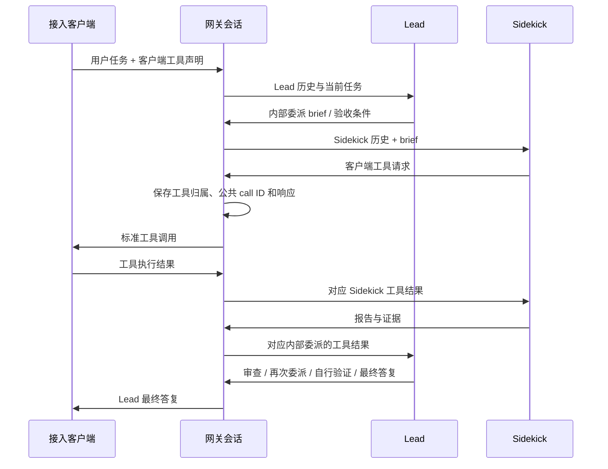

# 网关 Fusion Lead / Sidekick

实现采用 handoff 推荐的网关编排方案，策略版本 `gateway-fusion-v1`。它为 Devin 账号上的两个具体模型建立独立、持久的角色会话，通过标准客户端工具完成工作。没有解析官方私有 harness，也不声称与官方 CLI 的提示词、缓存或成本表现等价。

## 默认行为与覆盖

Fusion 默认开启，现有账号也立即适用，无需逐个创建 profile。请求的 model ID 若为 `fusion-<lead>-sidekick-<sidekick>`，网关从该账号目录解析两个真实成员，再启动持续的 Lead / Sidekick 编排。例如 `fusion-gpt-5.5-sidekick-gpt-5.4-nano` 在两个具体模型均可用、支持工具且已定价时即可使用。

解析优先匹配具体 UID 和目录提供的显式别名；只有匹配唯一时才容许 `.`、`_` 与 `-` 的拼写归一化。保留完整 fast/effort 等后缀，不用“差不多的型号”替代缺失成员。多个合法拆分或多个成员匹配会拒绝。裸 `fusion` 没有编码足够信息，需使用完整配对 ID 或添加覆盖。

公开 Fusion 条目即使包含 router/harness 元数据，仍只作为虚拟配对名称使用；不会把该条目或其 opaque harness 发给聊天接口。两个成员必须是账号可用、可直接调用的具体模型；成员自己的 router 或未知 harness 不会自动放行。这复现的是所选模型组合的网关协作机制，不证明私有官方 harness 的行为。

已核验的 CLI 客户端 harness 提示不会阻止具体成员的标准聊天调用。例如 Opus 的 `strawberry-pancake` 和 SWE-2 的 `swe-1p6*` 提示可以进入现有双角色编排，仍分别使用两个具体模型 UID 和独立 Cascade 历史。支持范围及未知提示的拒绝规则见 [模型路由](DEVIN_MODEL_ROUTING.md#cli-客户端-harness-提示)；不会把整个 Fusion ID 或其 `fusion` harness 当作单模型请求发送。

角色调用先将请求模型设为已固定的具体 Lead 或 Sidekick，再以 `direct_chat` 计划进入 `Prepare`，不会对公开 Fusion ID 调用 `AssignModel`。新版补充第 24.5 节报告：官方 Fusion 专用分配路径把 `assignment.model_uid` 用作 Sidekick；这不能套用普通 router 将分配结果作为唯一推理模型的规则。当前显式配对不依赖这条专用分配路径，也不从 `harness_uids` 提取 Sidekick UID；普通 router 的分配逻辑保持独立。

1. 同步账号模型目录后，已解析的配对会进入模型列表，并显示 Lead / Sidekick 成员。已有目录也会按当前策略重新计算展示。
2. 在「网关 Fusion 协作」可以关闭账号总开关、覆盖某个配对的模型和预算，或关闭同名配对。显式配置优先于自动推断；关闭覆盖不会因自动发现再次打开。
3. 若账号设置了模型白名单，也要允许该 Fusion model ID。已有“Fusion → 单模型”映射需要移除或改成完整配对，不能让协作请求降级为 Lead-only。
4. 两个真实 UID 需要明确的价格（精确价格表条目或分组/渠道覆盖）。计费不使用虚拟配对名，不按名称猜测费率。
5. 使用共享且持久化的 Redis。标准计费模式需要 `billing.inflight_reservation.enabled: true`（系统默认开启）、原子余额/额度预留和数据库 usage billing。缺少这些运行依赖时明确失败，不发起推理。

账号开关为 `extra.devin_fusion_enabled`；省略时视为 `true`。自定义/覆盖保存在 `extra.devin_fusion_profiles`。推断配对使用以下有界默认值；可通过覆盖修改：

```json
{
  "enabled": true,
  "public_model": "fusion-gpt-5.5-sidekick-gpt-5.4-nano",
  "lead_model_uid": "gpt-5.5",
  "sidekick_model_uid": "gpt-5.4-nano",
  "max_handoffs_per_turn": 4,
  "max_internal_requests_per_turn": 20,
  "max_external_tool_calls_per_turn": 40,
  "max_turn_wall_time_seconds": 900,
  "max_cost_usd_per_turn": 5,
  "max_context_bytes": 262144,
  "max_output_tokens": 4096,
  "session_ttl_seconds": 86400,
  "compaction": {
    "enabled": true,
    "max_attempts_per_role_per_turn": 2,
    "timeout_seconds": 30,
    "max_output_tokens": 1024
  }
}
```

示例 UID 用于展示解析形式，实际选择仍以该账号目录和授权为准。

自定义 profile 的公开别名（如 `fusion-team`）不必是上游目录中的条目。两个具体成员均可用且配置启用时，别名会加入 `/v1/models`、有效模型 ID 和管理路由视图；关闭、成员失效或账号 Fusion 总开关关闭时不再展示。原始提供方目录保持不变，自定义别名不虚构提供方上下文窗口等元数据。

## 三个 HTTP 协议的共同体验

| 接口 | 客户端收到 | 客户端回传 |
| --- | --- | --- |
| `/v1/responses` | `function_call` | `function_call_output` |
| `/v1/chat/completions` | `tool_calls` | `role: tool` |
| `/v1/messages` | `tool_use` | `tool_result` |

三个接口共用状态机；均支持 JSON 和 SSE。Responses 的固定 custom/freeform 工具及 namespace 通过已有可逆工具适配器转换，返回时恢复原工具形式。内部 `sub2api_sidekick` 永不对外发布，客户端也不能声明同名工具。每次只发布一个客户端工具调用。

上游偶尔会在请求禁用并行工具后仍返回多个客户端调用。网关将它们作为有界队列持久化，按原顺序逐个发布和接收结果；整批结果到齐前不再次调用角色模型。每个调用保留原角色、turn 和内部 call ID，预算在发布首个调用前按整批检查。排队期间的下一次发布没有新物理推理，公共 usage 为零，也不会重复入账。内部委派与其他调用混合的批次仍拒绝。回退到不识别队列的旧版本前，应先完成或取消这些待工具会话。

已完成的原生零参数调用可能不包含 `arguments_json`。只有明确声明为简单 object、没有必填字段或其他未知约束的工具，才将缺失参数补为 `{}`，并补齐 SSE 参数增量。必填参数、半截 JSON、未知工具及达到 token 上限的未完成调用仍拒绝，不能借此把截断结果标为完成。



每个新用户 turn 都要求至少一次委派。Lead 可以在报告后返工或自己调用客户端工具验证；后续委派继续使用同一条 Sidekick 历史。两个角色可以选同一个真实模型，但 Cascade 身份仍独立。

Lead 使用 `tool_choice=auto`，规划与审查阶段保持相同的工具声明和系统策略。部分带 thinking 的具体成员会拒绝强制指定工具，不能靠 named/required choice 保证委派。如果 Lead 尚未交接就给出文本，该文本只保留为私有草稿，每轮最多追加一次持久化的工作流提醒；再次未交接则明确失败，不发布单角色结果。提醒后的推理仍检查并消耗原有请求数、费用和耗时预算，草稿实际用量照常计费，重试不会重置提醒次数。保持工具集合稳定也避免在 Lead 恢复审查时主动改变可缓存前缀。

流式请求在内部阶段只发送保活注释，形成公共工具调用或最终结果后发布一个公共 Responses 生命周期，再转换到对应协议。内部推理、Sidekick 私有文本和报告不会混入最终用户流。

网关不执行 shell、文件读写或编辑工具。支持工具的客户端照常处理返回的标准工具调用；纯文本客户端可完成双角色分析/审查，但不能获得其没有提供的本地工作区能力。

## 会话和幂等

推荐显式使用：

```http
X-Sub2API-Fusion-Session: <稳定会话标识，1..128 字节、无空白/控制字符>
Idempotency-Key: <单次 HTTP 请求稳定标识，重试复用、不同请求更换>
```

未提供 Fusion session 头时，适配器可以使用现有显式会话头（如 `X-Session-Id`、`X-OpenCode-Session`、`X-Claude-Code-Session-Id`），并将其转成作用域内的稳定 ID。也支持以下协议关联：

- Responses 的 `previous_response_id`，只接受当前 API key / 用户范围内本运行时创建的响应。
- 客户端回传的公共 Fusion tool call ID，无须客户端改造私有工具协议。
- Chat / Messages 重发完整历史时，验证最后公共检查点并仅追加增量；重写、截断、分叉和工具 schema 改变会拒绝。

返回 `X-Sub2API-Fusion-Session` 和 `X-Sub2API-Fusion-State`。无可靠关联的新请求生成新 session；不使用 `prompt_cache_key` 或初始 prompt 的哈希合并会话。相同 API key 下两个独立会话若产生完全相同的公共历史，后续只有完整历史、没有其他关联时返回 `session_ambiguous`，要求显式 session。不同用户/API key 永不共享历史或工具映射。

每个会话固定账号、公开别名和 profile revision。修改启用中的配对不会替换已有会话的模型快照；关闭账号 Fusion、显式禁用配对或原账号不再可调度时显式停止，不迁移到别的账号。待工具期间不接受新用户消息；必须返回恰好一个对应结果。相同请求/结果重试返回持久响应及相同 call ID，冲突结果拒绝。初始请求也需要稳定 session 或 Idempotency-Key，才能识别“重试”与“独立的新任务”。

## 取消、断连与恢复

取消已有会话：向上述任一 HTTP 接口发送正常 JSON 请求，使用同一 API key，携带会话头及：

```http
X-Sub2API-Fusion-Cancel: true
```

返回 `cancel_requested`；等待工具的会话立即终止，正在进行的推理保留已知 usage 后终止。取消不会远程终止客户端已经执行的本地命令。已取消/过期的工具结果不能唤醒新 turn。

取消标记成功保存后，补账失败不会撤销或掩盖这次控制操作：仍返回 HTTP 200 / `cancel_requested`，并在费用尚待核对时附带 `usage_settlement: pending`。已知费用可在后续请求中继续结算，未知 attempt 保留预留；该回执不表示费用为零。取消标记本身无法保存时仍返回错误。

HTTP 断连不会创建新的角色调用。当前推理最多额外 drain 90 秒，且仍受 turn 截止时间约束；得到的 usage 持久结算。客户端用原输入和幂等键恢复，可继续已保存的角色状态或收到已保存的公共响应。

Redis 推进锁有有限租期，持久会话使用整份状态 CAS/revision；等待客户端工具时不持锁。每次实际推理前记录 attempt，得到结果后独立保存结果账本并同步结算，再更新会话。写入中断可从结果账本恢复；已知 usage 结算失败时暂停，重试只补账。provider 结果不明且没有可恢复终态时进入 `UNCERTAIN`，不会自动重发该推理。需要从上游/账务记录人工核对，不能把未知费用当作零。

## 双角色上下文压缩

网关压缩默认开启，可在每个配对的「角色上下文压缩」中关闭或配置独立阈值。省略 `compaction` 也使用上述默认值。Lead 与 Sidekick 分别使用本角色的具体模型做摘要；摘要没有执行工具权限，不是客户端 `/compact`，也不会重置客户端公共历史。

摘要复用正常 Devin 请求构造、鉴权、准备与计费流程，使用独立摘要会话，工具列表为空且 `tool_choice=none`；返回工具调用会使摘要失败。新版补充第 24.4 节报告官方 `file_compactor.compact` 也走共用推理构造器，支持这一实现方向，无需引入假定的专用 compact RPC。该内部 query label 不直接作为未经核验的上游字段发送。

输入估算使用序列化后的实际 Devin 请求和公共内部请求两者的较大字节数，作为保守 token 估算量，包含 system、tools、图片和工具结果。安全输入预算取账号具体模型窗口减去输出预留及估算余量，再与 `max_context_bytes` 取较小值。它不是官方 tokenizer 或官方默认阈值。自动阈值为安全输入预算的 60% / 75% / 90%：

- `spawn`：有可摘要的完整旧前缀且有后台容量时，准备一个摘要。
- `apply`：在下一次正常角色推理前，应用已就绪且能缩小输入的摘要。
- `hard`：禁止正常推理继续。有限等待已有摘要，或在当前请求槽内同步摘要；仍无法容纳时返回明确的容量错误。

可选 `lead_thresholds` / `sidekick_thresholds` 使用 `[spawn, apply, hard]`，或 `[spawn, hard]`（明确解释为 `apply=hard`）。Sidekick 留空沿用 Lead；两者留空才按各自模型预算自动计算。配置超过任一真实模型的安全预算会在正常推理前拒绝。关闭自动压缩仍保留 hard gate。

Lead 的用户目标、system/developer 约束、当前 turn 最近交接的调用/报告配对，以及 Sidekick 的活动 brief 原文保留。切分点只落在已配对工具组的边界，最近执行后缀完整保留；未返回的工具调用不能被摘要替代。原前缀写入与会话相同保护范围的 TTL 归档，再通过会话 CAS 提交新角色视图、来源 digest、job ID 和独立 context epoch。单会话归档来源累计上限 12 MiB，达到上限后不再准备付费摘要；hard gate 仍生效。摘要以普通历史数据注入，不提升为 system 指令或真实测试证据。

后台 job 绑定 role、profile、context epoch、原前缀 digest 及切分点。只追加后缀不会使摘要失效；改写、重复应用、取消或前缀替换会阻止应用。每角色最多一个在途 job，默认每 turn 最多两次、每次 30 秒；每个 Devin 运行实例最多 16 个后台摘要。后台不排队，先检查前台等待，并给账号和用户各留一个前台槽；容量不足时跳过软优化，hard gate 使用当前请求已有的槽，避免容量为 1 时死锁。

摘要使用独立 `purpose=compaction` attempt 和账单，包含在本轮调用数、费用及原子余额/额度预留中。标准公共 usage 只汇总正常业务推理，不回填 HTTP 之间的后台费用；费用明细的模型映射链标记 `compaction/lead` 或 `compaction/sidekick`。会话在后续推进时归并摘要 token/费用、准备/应用/失败/stale 次数；`audit.devin.fusion` 记录有界阶段、job ID 和输入前后大小，不记录摘要或原文。摘要无效、未应用或迟到仍可能产生真实费用。

后续会话推进会读取已保存结果，只补结算或安全应用；没有终态的已发送摘要不自动重放，预算预留不能当作零。没有额外启动离线会话扫描器。后台调用使用独立的不可变请求元数据和有限 context，不保留已结束 HTTP 的 Gin writer。正常发完工具响应可让摘要在限时内继续；异常断连、显式取消和任务终态会取消本进程相关后台工作，迟到结果只按状态校验处理。

已取消、失败、预算耗尽或结果不确定的会话再次收到推进请求时，仍先核对并补结算已知摘要 usage，再返回停止状态；不会应用摘要、重新发起推理或重启任务。重复核对按同一 attempt 去重。

已有会话的费用恢复在 HTTP 绑定阶段、账号调度和当前模型授权检查之前执行，只使用原账号和当前认证 scope 补账，不刷新凭据或调用上游。原账号暂停、限流、配对关闭或模型从目录移除，不会阻断已知费用结算；这不放宽任何新推理的授权。推理与两个角色的摘要分别核对，一笔未知结果不会阻挡其他已知 usage 入账。未知费用仍保留预留，不自动重发；取消标记仍可收束任务状态。

## Lead 缓存预热（默认开启，可关闭）

`devin-full-prefix-one-token-v4` adapter 对所有已通过 Fusion 路由、工具能力及价格校验的具体 Lead 模型通用，支持目录自动配对与自定义 profile，不限制单一模型 UID。进程配置 `gateway.devin_fusion_cache_warm_enabled` 默认 `true`（环境变量 `GATEWAY_DEVIN_FUSION_CACHE_WARM_ENABLED=false` 可关闭）；profile 省略 `cache_keepalive` 或省略其中的 `enabled` 时继承开启，显式 `"enabled": false` 始终关闭。费用恢复在开关关闭后仍可执行。SSE 的 `: keepalive` 只维护 HTTP 连接。

默认每 240 秒检查一次，等待窗口最多 900 秒、每 turn 最多两次、每次最多 30 秒，独立金额上限为 `min($0.50, profile turn 上限)`。原 turn 截止时间、session TTL、共用费用预算和前台容量限制同时生效，因此短 turn 不会触发预热。自定义启用的部分策略继承缺省值；负值或超出合法范围仍拒绝。

adapter 深拷贝成功 Lead 请求的完整 input、instructions、工具和采样参数，保持 Lead Cascade scope，只把实际请求输出上限改为 1，并使用新 execution ID。这不等同于官方 CLI 的私有 keepalive 协议。原生实测发现 GPT 成员的一 token 请求会报告 32 个 output tokens，直接把 wire 上限增到 32 反而产生 111–197 个 tokens；因此保留一 token wire 请求，GPT 的估价和结果上限单独按 32 计算，其他成员按 1 计算。无法满足费用预留、授权、身份或用量校验的请求不会继续调度。

快照同时保存原请求的配额平台、客户端模型名和账号映射入口，后台预热及后续补账沿用同一平台；composite 分组按原始别名重新检查当前分组白名单。新预热还会重新加载用户的分组授权，并检查账号当前模型白名单与映射目标。撤销权限会阻止新预热，但不阻止已发生费用结算。独立缓存账本也在 HTTP 绑定阶段恢复，因此取消或关闭预热后仍可补账；未知结果继续保留预留，不重发。准备账本先于待处理标记保存，初次写入失败会释放未发送请求的预算。窗口截止时间随当前窗口持久化，旧回调不会缩短新一轮的预热窗口。

候选绑定用户/API key scope、账号、具体模型、profile revision、Lead context epoch、原前缀及工具合同 digest，并保存不含凭据的计费身份。只有 Sidekick 的当前委派尚未报告时才能 arm；正常工具响应结束后可继续有限等待。Sidekick 单独更新或压缩不重置 Lead due time；Lead 恢复、报告进入 Lead、Lead 压缩、取消、异常断连或终态会失效旧快照。关闭窗口保留独立未结算 attempt，迟到结果不能重新 arm 新窗口。

以下参数已经是默认值；只需在修改限制或关闭时添加 `cache_keepalive`：

```json
"cache_keepalive": {
  "enabled": true,
  "interval_seconds": 240,
  "max_window_seconds": 900,
  "max_attempts_per_turn": 2,
  "max_cost_usd_per_turn": 0.5,
  "timeout_seconds": 30
}
```

定时器每个 Devin 服务实例最多跟踪 128 个窗口，同时运行 4 个 tick，无排队、无错过周期的补发、无重启扫描。每个 session 还需取得共享 refresh lease 和 epoch/window claim；不同进程不能重复发送同一在途请求。账号和用户容量由现有共享并发服务非排队获取，各保留一个前台槽；任一并发上限为 1、前台已有等待或容量不足时跳过。停止服务会取消 worker 并限时等待收束。

每次发送前重新读取 API key、用户状态、账号、订阅、profile、路由及模型授权，重新获取有效 token/assignment；不保留 Gin writer、前台 executor 或认证 token。模型权限 discovery 必须成功，两个成员都需要可识别的真实 UID 价卡；未知价格、额度/余额预留失败或发送前估价增加均拒绝。准入使用全冷输入及 cache write 的保守上界，不假定缓存命中。普通推理、摘要和预热共用 CAS 原子 turn 费用账本，因此并发估价不能各自通过后超额发送。费用账本按 attempt 去重，未知结果继续占用预算；预热也有独立次数、时间和金额上限。

预热使用独立的终态和用量判定：Connect trailer 正常结束、明确且非全零的 usage、模型身份无冲突、计费输出不超过对应预算，才算请求成功。缺少 `stop_reason` 但干净结束的流也可成功；partial、error、过滤、断流和全零 usage 不被当作有效预热。供应商报告 cache read 或 cache write 才确认缓存活动；不同模型按不同块大小报告缓存，不能把 Opus 的 90% 阈值套给所有模型，也不声称该确认等于完整前缀命中。

文本、思考、签名及工具片段都只计入一个 `discarded_output` 标记；统计 decoder 不接收这些输出，不执行工具，不把结果写入业务历史或公共响应。没有缓存证据时停止当前窗口，不以 HTTP 成功冒充缓存确认；全零或不完整 usage 保留未知预算，不按免费结算。

所有已知终态 usage 通过现有持久账务服务以 `fusion:<attempt UUID>` 单独结算，模型映射链标记 `cache_refresh/lead`。预热不进入任何业务 lane、工具分发或公共 response usage。失去网络或取消可能留下未知费用；保留原预算和余额/额度预留，绝不记为免费或自动重放。已知账务失败可从独立 journal 重试结算，即使窗口已停止或快照已清除；进程预热开关关闭后仍允许已知费用恢复。变更了原计费组等无法可靠恢复的身份会保留 pending，避免给其他组记账。账本和预留仍受各自 TTL 约束。

本进程通过取消函数中止请求，其他进程的取消、epoch/window 失效或 Sidekick 结束由 250ms 栅栏轮询中止；不会取消已经发出的请求可能产生的费用。已知迟到 usage 仍结算，缺失终态的结果保留未知，worker 不重发。费用恢复只影响独立账本，不修改业务历史。

### 隔离验证证据

2026-10-23 的首次原生 A/B 使用两组独立随机前缀：初始缓存写入后约 6.5–7 分钟恢复，无中途请求组 cache-read/input 为 8.21%；第 4 分钟增加一次一 token 请求的组为 99.95%。改变系统提示或工具定义会破坏对应前缀；相同前缀换 Cascade ID 仍可能命中，因此冷组不能只更换会话 ID。这是普通全前缀请求的有限实验，不证明 CLI 私有协议、长期稳定性或净收益。

本次真实 adapter + 自动定时器的加速隔离验证：冷写入后两次自动预热，各 6,103 个 input token（其中 cache read 6,099）、1 个 output token、零可见输出，命中占比 99.93%，业务快照完全不变。按测试环境显式价卡，两次预热共 $0.0025116；初始化冷写入另计 $0.030531。第四个一 token 请求在 HTTP 确认发出后由另一 controller 取消，未收到终态 usage，保留 $0.137576 保守预留，没有重发。这些金额是隔离账本按配置价格换算的结果，不是 Devin 最终账单。测试没有修改生产服务或开关。

回归覆盖：60 个并发费用准入、正常推理/摘要/预热竞争同一预算、64 个并发容量申请保留前台槽、重复 tick、多实例互斥、窗口到期、worker/watch 上限、关闭、超时、本地/跨进程取消、迟到已知 usage、未知预留、账务失败后恢复去重、变更权限/价格/路由的拒绝，以及实际网关入口、默认开启与显式 opt-out。

2026-10-23 的全目录检查遍历了 575 个原生 Fusion ID：545 个配置、70 个具体 Lead 通过解析、默认策略、完整前缀构造及隔离显式价卡下的准入检查（不替代生产缺失价卡的配置）；未发送推理。155 个原先因 `-fast` / `-priority` 名称不一致的配置，现在只有在相同基础型号/effort 的目录成员明确带有 Fast Mode 元数据时，解析到其 `-priority` UID。另 30 个 Fable/Sonnet Fast 条目没有对应可调用的具体成员，仍明确拒绝，绝不改成普通档或其他 effort。

跨模型实测覆盖 Opus 5/5.5（含 Fast）、Fable、Sonnet、Haiku、GPT 各家族、SWE、GLM 和 Gemini。首次 26 个有完整记录的诊断请求暴露了 GPT 的 32-token 用量行为；额外的 wire=32 试验 6 次证明会产生更多输出，已放弃该请求形态。恢复 wire=1、单独预留 GPT 32-token 用量后，5 个 GPT 成员的冷/热 10 次请求通过；Luna 则在后续测试返回全零 usage，按未知停止，不能宣称该上游状态已恢复。其他成员的热输入缓存读取占比从 SWE 约 46%、Gemini 约 54% 到 Claude 约 99.9% 不等；没有把部分缓存描述为全量命中。上述实验均使用临时账务与合成输入，没有修改生产。

## 费用与限制

- 每次实际 Lead/Sidekick 推理按真实 billing model、独立 token/cache 桶及当次计费时点计算，使用稳定 `fusion:<attempt UUID>` 入账 ID；外层 request ID 不会把多个角色费用去重成一笔。
- 公共响应 usage 只汇总该 HTTP 推进请求触发的正常推理 attempts；不是整个 session 累计。重放返回原响应，不再次收费。公共 usage 包含私有规划与报告；摘要与缓存预热独立记账。
- 每次推理重新检查余额/订阅/API key/RPM，确认原子在途预留。预留覆盖推理截止时间和 drain 窗口，结算完成才释放；缓存故障拒绝下一次调用。
- 费用准入采用保守 token 估价和输出上限。终态使用上游真实 usage；估价不能替代上游的最终账单。实际费用超限后停止后续推理。
- 角色上下文受配置字节数和真实模型窗口的保守上界约束；压缩有明确策略、来源归档与费用记录，不截断工具结果或 rewind。单会话至多 256 个 HTTP 推进请求，持久快照最多 12 MiB；压缩不会缩减客户端公共检查点或无限扩大持久存储上限。
- session 到期后不再接受推进；历史及结果账本有 TTL，账本额外保留一天用于故障核对，费用去重由现有数据库账务层承担。

当前合同要求固定的客户端工具声明，支持 tool choice `auto`/`none`。不支持动态 tool discovery、更改 schema、并行执行工具、多 Sidekick、任意 steering、结构化最终输出、`store:true` 及公共 response retrieval；上游的客户端工具批次按上述规则串行处理。WebSocket 接入应使用客户端的 HTTP Responses 模式；本实现的协议适配范围是上述三个 HTTP 接口。不能据此声称所有客户端默认配置都已真实联调。

## 验证与观测

定向测试：

```sh
cd backend
go test -race ./internal/pkg/devin/fusion
go test -tags=unit ./internal/service ./internal/handler ./internal/server/middleware -run 'TestFusion|TestDevin|TestCORS'
```

覆盖：三协议 × JSON/SSE 的完整客户端工具往返和逐次计费；两次委派、两角色独立上下文、Lead 工具验证；进程重建后的持久恢复、CAS 并发、幂等冲突、跨 API key 隔离、取消/TTL、断连后停止、未知推理不重发、补账、费用与上下文预算。额外覆盖 Responses custom/namespace 工具的可逆适配和默认启用、自动推断与显式关闭，以及分角色摘要、安全工具切分、原文保护、迟到/重复/stale 结果、来源归档、独立计费和虚拟时钟下的缓存生命周期。

`audit.devin.fusion` 记录每次推理的角色、attempt ID、真实模型和 usage 是否已观察到；日志不包含凭据、JWT、brief、工具输出或私有正文。完整角色历史只存在有 TTL 的会话/结果存储中。

自动化测试使用模拟上游及隔离 Redis。2026-10-23 的兼容修复额外用真实上游 Opus 5.5 + SWE-2 完成了隔离的三轮计算任务，核对双角色执行、缓存读写与幂等重放；这些调用可能消耗上游额度，未写生产配置或生产账单。该验证不等同于目标客户端的端到端验收或完整生产计费验证。Codex/Claude Code/OpenCode 的真实文件/命令工具、部署配置和所有模型组合仍需单独验收。

同日扩展验收固定抽取 HumanEval 和 MBPP sanitized 各 6 题，种子 `20261023`；仅从纯标准库、参考程序能够通过判题器的候选中抽样，MBPP 采用官方 test split。公开样例供受限 `read_file` / `write_file` / `run_tests` 协作使用，最终官方断言独立保留。任务明确要求 Lead 在每份 Sidekick 报告后亲自复测，失败时再委派，不能由此推导未提出该要求的任务也必定重验。

首轮 11/12 完成协作并通过最终断言；另一题发现批返回兼容问题，修复后在新会话复测通过。前置试跑另发现零参数工具解码问题。一轮复测出现传输 EOF，按结果未知的网络异常单列，不自动重放原请求。陈旧 Sidekick 报告故障通过 Lead 复测及二次委派恢复，测试服务暂时失败也成功恢复。该评测包含工具反馈和开发期间修复，不是官方 HumanEval/MBPP pass@1，也不是冻结版本的全量基准成绩。

另有一项受控的真实上游批返回用例：仅在测试中显式允许并要求 Sidekick 同批返回 `write_file` 和 `run_tests`，网关逐个发布，两次客户端工具执行之间没有新增物理推理，随后 Sidekick 报告、Lead 独立复测和最终断言均通过。该兼容用例不计入上述 12 题成绩，也没有改变生产请求禁用并行工具的策略。

数据源固定为 [HumanEval](https://github.com/openai/human-eval/tree/463c980b59e818ace59f6f9803cd92c749ceae61) 和 [MBPP sanitized](https://github.com/google-research/google-research/blob/f82046ba5aabbbb427dbfd38a254d26bff08b533/mbpp/sanitized-mbpp.json)。题目 ID、数据哈希、角色工具轨迹、初轮失败及复测、缓存干预用量和被废弃的实验对照均保留在本次验证报告中；没有将账号凭据或原始认证报文提交到仓库。
