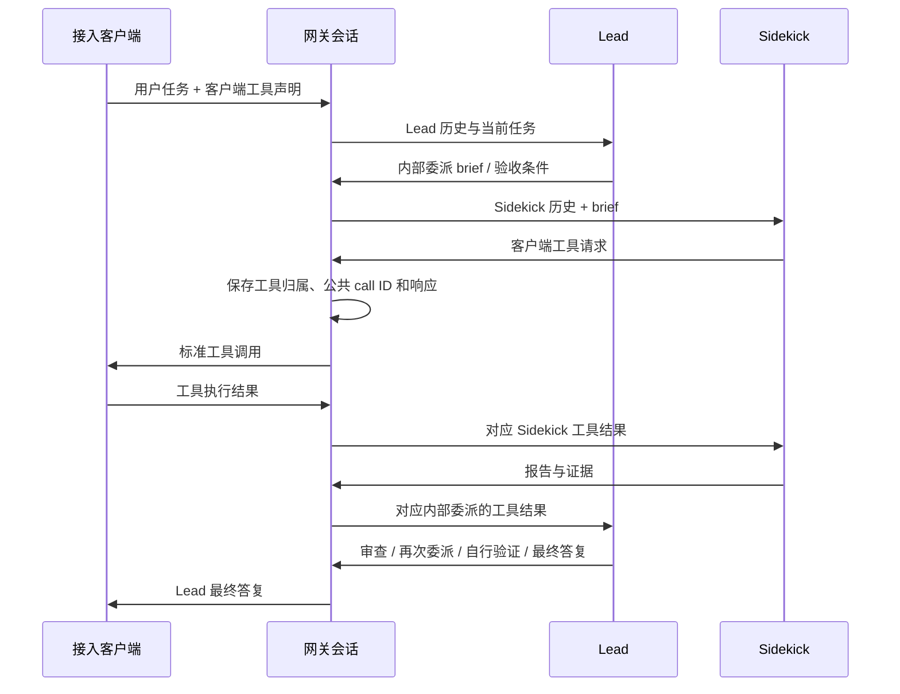

# 网关 Fusion Lead / Sidekick

实现采用 handoff 推荐的网关编排方案，策略版本 `gateway-fusion-v1`。它为 Devin 账号上的两个具体模型建立独立、持久的角色会话，通过标准客户端工具完成工作。没有解析官方私有 harness，也不声称与官方 CLI 的提示词、缓存或成本表现等价。

## 默认行为与覆盖

Fusion 默认开启，现有账号也立即适用，无需逐个创建 profile。请求的 model ID 若为 `fusion-<lead>-sidekick-<sidekick>`，网关从该账号目录解析两个真实成员，再启动持续的 Lead / Sidekick 编排。例如 `fusion-gpt-5.5-sidekick-gpt-5.4-nano` 在两个具体模型均可用、支持工具且已定价时即可使用。

解析优先匹配具体 UID 和目录提供的显式别名；只有匹配唯一时才容许 `.`、`_` 与 `-` 的拼写归一化。保留完整 fast/effort 等后缀，不用“差不多的型号”替代缺失成员。多个合法拆分或多个成员匹配会拒绝。裸 `fusion` 没有编码足够信息，需使用完整配对 ID 或添加覆盖。

公开 Fusion 条目即使包含 router/harness 元数据，仍只作为虚拟配对名称使用；不会把该条目或其 opaque harness 发给聊天接口。两个成员必须是账号可用、可直接调用的具体模型；成员自己的 router 或未知 harness 不会自动放行。这复现的是所选模型组合的网关协作机制，不证明私有官方 harness 的行为。

角色调用先将请求模型设为已固定的具体 Lead 或 Sidekick，再以 `direct_chat` 计划进入 `Prepare`，不会对公开 Fusion ID 调用 `AssignModel`。新版补充第 24.5 节报告：官方 Fusion 专用分配路径把 `assignment.model_uid` 用作 Sidekick；这不能套用普通 router 将分配结果作为唯一推理模型的规则。当前显式配对不依赖这条专用分配路径，也不从 `harness_uids` 提取 Sidekick UID；普通 router 的分配逻辑保持独立。

1. 同步账号模型目录后，已解析的配对会进入模型列表，并显示 Lead / Sidekick 成员。已有目录也会按当前策略重新计算展示。
2. 在「网关 Fusion 协作」可以关闭账号总开关、覆盖某个配对的模型和预算，或关闭同名配对。显式配置优先于自动推断；关闭覆盖不会因自动发现再次打开。
3. 若账号设置了模型白名单，也要允许该 Fusion model ID。已有“Fusion → 单模型”映射需要移除或改成完整配对，不能让协作请求降级为 Lead-only。
4. 两个真实 UID 需要明确的价格（精确价格表条目或分组/渠道覆盖）。计费不使用虚拟配对名，不按名称猜测费率。
5. 使用共享且持久化的 Redis。标准计费模式需要 `billing.inflight_reservation.enabled: true`（系统默认开启）、原子余额/额度预留和数据库 usage billing。缺少这些运行依赖时明确失败，不发起推理。

账号开关为 `extra.devin_fusion_enabled`；省略时视为 `true`。自定义/覆盖保存在 `extra.devin_fusion_profiles`。推断配对使用以下有界默认值；可通过覆盖修改：

```json
{
  "enabled": true,
  "public_model": "fusion-gpt-5.5-sidekick-gpt-5.4-nano",
  "lead_model_uid": "gpt-5.5",
  "sidekick_model_uid": "gpt-5.4-nano",
  "max_handoffs_per_turn": 4,
  "max_internal_requests_per_turn": 20,
  "max_external_tool_calls_per_turn": 40,
  "max_turn_wall_time_seconds": 900,
  "max_cost_usd_per_turn": 5,
  "max_context_bytes": 262144,
  "max_output_tokens": 4096,
  "session_ttl_seconds": 86400,
  "compaction": {
    "enabled": true,
    "max_attempts_per_role_per_turn": 2,
    "timeout_seconds": 30,
    "max_output_tokens": 1024
  }
}
```

示例 UID 用于展示解析形式，实际选择仍以该账号目录和授权为准。

## 三个 HTTP 协议的共同体验

| 接口 | 客户端收到 | 客户端回传 |
| --- | --- | --- |
| `/v1/responses` | `function_call` | `function_call_output` |
| `/v1/chat/completions` | `tool_calls` | `role: tool` |
| `/v1/messages` | `tool_use` | `tool_result` |

三个接口共用状态机；均支持 JSON 和 SSE。Responses 的固定 custom/freeform 工具及 namespace 通过已有可逆工具适配器转换，返回时恢复原工具形式。内部 `sub2api_sidekick` 永不对外发布，客户端也不能声明同名工具。每次只发布一个客户端工具调用。



每个新用户 turn 都要求至少一次委派。Lead 可以在报告后返工或自己调用客户端工具验证；后续委派继续使用同一条 Sidekick 历史。两个角色可以选同一个真实模型，但 Cascade 身份仍独立。

流式请求在内部阶段只发送保活注释，形成公共工具调用或最终结果后发布一个公共 Responses 生命周期，再转换到对应协议。内部推理、Sidekick 私有文本和报告不会混入最终用户流。

网关不执行 shell、文件读写或编辑工具。支持工具的客户端照常处理返回的标准工具调用；纯文本客户端可完成双角色分析/审查，但不能获得其没有提供的本地工作区能力。

## 会话和幂等

推荐显式使用：

```http
X-Sub2API-Fusion-Session: <稳定会话标识，1..128 字节、无空白/控制字符>
Idempotency-Key: <单次 HTTP 请求稳定标识，重试复用、不同请求更换>
```

未提供 Fusion session 头时，适配器可以使用现有显式会话头（如 `X-Session-Id`、`X-OpenCode-Session`、`X-Claude-Code-Session-Id`），并将其转成作用域内的稳定 ID。也支持以下协议关联：

- Responses 的 `previous_response_id`，只接受当前 API key / 用户范围内本运行时创建的响应。
- 客户端回传的公共 Fusion tool call ID，无须客户端改造私有工具协议。
- Chat / Messages 重发完整历史时，验证最后公共检查点并仅追加增量；重写、截断、分叉和工具 schema 改变会拒绝。

返回 `X-Sub2API-Fusion-Session` 和 `X-Sub2API-Fusion-State`。无可靠关联的新请求生成新 session；不使用 `prompt_cache_key` 或初始 prompt 的哈希合并会话。相同 API key 下两个独立会话若产生完全相同的公共历史，后续只有完整历史、没有其他关联时返回 `session_ambiguous`，要求显式 session。不同用户/API key 永不共享历史或工具映射。

每个会话固定账号、公开别名和 profile revision。修改启用中的配对不会替换已有会话的模型快照；关闭账号 Fusion、显式禁用配对或原账号不再可调度时显式停止，不迁移到别的账号。待工具期间不接受新用户消息；必须返回恰好一个对应结果。相同请求/结果重试返回持久响应及相同 call ID，冲突结果拒绝。初始请求也需要稳定 session 或 Idempotency-Key，才能识别“重试”与“独立的新任务”。

## 取消、断连与恢复

取消已有会话：向上述任一 HTTP 接口发送正常 JSON 请求，使用同一 API key，携带会话头及：

```http
X-Sub2API-Fusion-Cancel: true
```

返回 `cancel_requested`；等待工具的会话立即终止，正在进行的推理保留已知 usage 后终止。取消不会远程终止客户端已经执行的本地命令。已取消/过期的工具结果不能唤醒新 turn。

HTTP 断连不会创建新的角色调用。当前推理最多额外 drain 90 秒，且仍受 turn 截止时间约束；得到的 usage 持久结算。客户端用原输入和幂等键恢复，可继续已保存的角色状态或收到已保存的公共响应。

Redis 推进锁有有限租期，持久会话使用整份状态 CAS/revision；等待客户端工具时不持锁。每次实际推理前记录 attempt，得到结果后独立保存结果账本并同步结算，再更新会话。写入中断可从结果账本恢复；已知 usage 结算失败时暂停，重试只补账。provider 结果不明且没有可恢复终态时进入 `UNCERTAIN`，不会自动重发该推理。需要从上游/账务记录人工核对，不能把未知费用当作零。

## 双角色上下文压缩

网关压缩默认开启，可在每个配对的「角色上下文压缩」中关闭或配置独立阈值。省略 `compaction` 也使用上述默认值。Lead 与 Sidekick 分别使用本角色的具体模型做摘要；摘要没有执行工具权限，不是客户端 `/compact`，也不会重置客户端公共历史。

摘要复用正常 Devin 请求构造、鉴权、准备与计费流程，使用独立摘要会话，工具列表为空且 `tool_choice=none`；返回工具调用会使摘要失败。新版补充第 24.4 节报告官方 `file_compactor.compact` 也走共用推理构造器，支持这一实现方向，无需引入假定的专用 compact RPC。该内部 query label 不直接作为未经核验的上游字段发送。

输入估算使用序列化后的实际 Devin 请求和公共内部请求两者的较大字节数，作为保守 token 估算量，包含 system、tools、图片和工具结果。安全输入预算取账号具体模型窗口减去输出预留及估算余量，再与 `max_context_bytes` 取较小值。它不是官方 tokenizer 或官方默认阈值。自动阈值为安全输入预算的 60% / 75% / 90%：

- `spawn`：有可摘要的完整旧前缀且有后台容量时，准备一个摘要。
- `apply`：在下一次正常角色推理前，应用已就绪且能缩小输入的摘要。
- `hard`：禁止正常推理继续。有限等待已有摘要，或在当前请求槽内同步摘要；仍无法容纳时返回明确的容量错误。

可选 `lead_thresholds` / `sidekick_thresholds` 使用 `[spawn, apply, hard]`，或 `[spawn, hard]`（明确解释为 `apply=hard`）。Sidekick 留空沿用 Lead；两者留空才按各自模型预算自动计算。配置超过任一真实模型的安全预算会在正常推理前拒绝。关闭自动压缩仍保留 hard gate。

Lead 的用户目标、system/developer 约束、当前 turn 最近交接的调用/报告配对，以及 Sidekick 的活动 brief 原文保留。切分点只落在已配对工具组的边界，最近执行后缀完整保留；未返回的工具调用不能被摘要替代。原前缀写入与会话相同保护范围的 TTL 归档，再通过会话 CAS 提交新角色视图、来源 digest、job ID 和独立 context epoch。单会话归档来源累计上限 12 MiB，达到上限后不再准备付费摘要；hard gate 仍生效。摘要以普通历史数据注入，不提升为 system 指令或真实测试证据。

后台 job 绑定 role、profile、context epoch、原前缀 digest 及切分点。只追加后缀不会使摘要失效；改写、重复应用、取消或前缀替换会阻止应用。每角色最多一个在途 job，默认每 turn 最多两次、每次 30 秒；每个 Devin 运行实例最多 16 个后台摘要。后台不排队，先检查前台等待，并给账号和用户各留一个前台槽；容量不足时跳过软优化，hard gate 使用当前请求已有的槽，避免容量为 1 时死锁。

摘要使用独立 `purpose=compaction` attempt 和账单，包含在本轮调用数、费用及原子余额/额度预留中。标准公共 usage 只汇总正常业务推理，不回填 HTTP 之间的后台费用；费用明细的模型映射链标记 `compaction/lead` 或 `compaction/sidekick`。会话在后续推进时归并摘要 token/费用、准备/应用/失败/stale 次数；`audit.devin.fusion` 记录有界阶段、job ID 和输入前后大小，不记录摘要或原文。摘要无效、未应用或迟到仍可能产生真实费用。

后续会话推进会读取已保存结果，只补结算或安全应用；没有终态的已发送摘要不自动重放，预算预留不能当作零。没有额外启动离线会话扫描器。后台调用使用独立的不可变请求元数据和有限 context，不保留已结束 HTTP 的 Gin writer。正常发完工具响应可让摘要在限时内继续；异常断连、显式取消和任务终态会取消本进程相关后台工作，迟到结果只按状态校验处理。

已取消、失败、预算耗尽或结果不确定的会话再次收到推进请求时，仍先核对并补结算已知摘要 usage，再返回停止状态；不会应用摘要、重新发起推理或重启任务。重复核对按同一 attempt 去重。

已有会话的费用恢复在 HTTP 绑定阶段、账号调度和当前模型授权检查之前执行，只使用原账号和当前认证 scope 补账，不刷新凭据或调用上游。原账号暂停、限流、配对关闭或模型从目录移除，不会阻断已知费用结算；这不放宽任何新推理的授权。推理与两个角色的摘要分别核对，一笔未知结果不会阻挡其他已知 usage 入账。未知费用仍保留预留，不自动重发；取消标记仍可收束任务状态。

## Lead 缓存保活基础

缓存优化与 Fusion 总开关独立。当前实现的是缓存生命周期、不可变候选身份、独立 epoch、固定等待窗口、due claim、并发栅栏、独立 `cache_refresh` 账本和恢复控制。**没有注册真实 Devin refresh adapter，也没有启动生产 refresh 定时器；不会发送保活推理。** SSE 的 `: keepalive` 仅维护 HTTP 连接，不是模型缓存续期。

候选身份包括租户/API key scope、账号、凭据/路由身份 digest、具体 Lead 模型、profile revision、Lead context epoch、请求前缀及工具合同 digest。协议未验证时只保留候选元数据，不额外复制整份 prompt。Sidekick 单独更新或压缩不重置 Lead cache epoch；Lead 正常推理、报告进入 Lead、Lead 压缩、取消、异常断连或终态会失效旧快照。正常工具响应结束则保留有限等待窗口。

控制器可以通过可控 adapter 和虚拟时钟验证：首次到期、同一窗口单在途、资源紧张跳过、固定次数/时长/费用预算、旧 owner/epoch 回调只结算不重新 arm、未知 attempt 保留预算且不重放，以及重启不补发错过的 tick。HTTP 请求成功与明确缓存确认分开记录；普通文本或工具输出会停止该窗口，绝不执行或写入会话。

`cache_keepalive` 默认关闭。未来经验证的适配器还须提供明确的请求形态、能力范围、鉴权/assignment 生命周期、低优先级容量和原子费用预留；接入生产调度前还需明确费用归属，将并发 refresh 与正常推理接入同一原子 turn 预算，并通过真实账号的净成本/延迟对照。当前后台刷新费用为零，因为没有发送此类请求；这不表示已证明真实缓存收益。

### 新版静态证据与当前实现的关系

来源为 `sub2api-devin-fusion-cache-keepalive-patch-2026-10-22.md` 新增第 24–26 节。该补充报告对 CLI `3000.11.92`、macOS arm64、SHA-256 `623c03a8ad06fef8ff50148c52834846348336c600fbc5267f7387c8d07fe18f` 的 LLVM/Ghidra 静态分析；本仓库没有独立复核该二进制或完成真实请求验证。

| 补充报告的证据 | 当前实施决策 |
| --- | --- |
| 内部 `query_label=cache_keepalive`、`is_user_initiated=false`、`temperature=0`、`max_tokens=1`，top-p/top-k 未设置 | 小输出推理已有候选依据；这些是内部语义，尚不能转换为已验证的 wire 请求 |
| 一条分支复制会话链后临时追加 `user: continue`，另一条读取已保存请求历史 | 不向正式 transcript 追加 `continue`，也不据此统一重放最后一条消息 |
| 默认分支 285 秒、至多 11 次；特定模型能力分支 1680 秒、至多 2 次；元数据 `24h` 分支跳过 | 仅作为绑定具体能力与 CLI 版本的实验候选；不写入全局默认值，不按公开名称前缀猜测适用模型，不推导服务端 TTL |
| 最终端点、缓存控制字段、动态 hook、harness 与 assignment JWT 契约仍未闭合 | 不猜 protobuf tag，不注册生产 refresh adapter，不启动生产定时器 |

现有普通 `devin.BuildRequest` 还会把温度 0 转为 0.0001、默认填入 top-p=1；当前子集协议也没有上述内部 query label / user-initiated 字段的已核验映射。因此仅复制正常请求并设置输出上限 1，不能复现新版报告的保活语义；不能把普通请求构造器直接注册为已验证 refresh adapter。后续需要专门核验字段存在性、完整历史分支、前缀关系和最终 wire fixture，再决定如何表达这些语义。

首次真实验证应固定一个适用模型对、测试账号作用域、CLI build、网关 revision、profile 和 adapter shape version，预先限定调用数、时长与费用。使用互不预热的独立 session，依次保留脱敏官方请求样本、候选请求逐字段差异、无保活/有限保活的配对对照，以及取消和压缩后的迟到结果。按 attempt 汇总正常推理、摘要、刷新及已发生失败/重试的费用，比较 Lead 恢复时的真实 cache usage 与时延；HTTP 成功或单次命中都不能替代净收益结论。上游未提供 cache usage 时保留未知，不宣称续期成功。

## 费用与限制

- 每次实际 Lead/Sidekick 推理按真实 billing model、独立 token/cache 桶及当次计费时点计算，使用稳定 `fusion:<attempt UUID>` 入账 ID；外层 request ID 不会把多个角色费用去重成一笔。
- 公共响应 usage 只汇总该 HTTP 推进请求触发的正常推理 attempts；不是整个 session 累计。重放返回原响应，不再次收费。公共 usage 包含私有规划与报告；摘要独立记账。
- 每次推理重新检查余额/订阅/API key/RPM，确认原子在途预留。预留覆盖推理截止时间和 drain 窗口，结算完成才释放；缓存故障拒绝下一次调用。
- 费用准入采用保守 token 估价和输出上限。终态使用上游真实 usage；估价不能替代上游的最终账单。实际费用超限后停止后续推理。
- 角色上下文受配置字节数和真实模型窗口的保守上界约束；压缩有明确策略、来源归档与费用记录，不截断工具结果或 rewind。单会话至多 256 个 HTTP 推进请求，持久快照最多 12 MiB；压缩不会缩减客户端公共检查点或无限扩大持久存储上限。
- session 到期后不再接受推进；历史及结果账本有 TTL，账本额外保留一天用于故障核对，费用去重由现有数据库账务层承担。

当前合同要求固定的客户端工具声明，支持 tool choice `auto`/`none`。不支持动态 tool discovery、更改 schema、并行工具、多 Sidekick、任意 steering、结构化最终输出、`store:true` 及公共 response retrieval。WebSocket 接入应使用客户端的 HTTP Responses 模式；本实现的协议适配范围是上述三个 HTTP 接口。不能据此声称所有客户端默认配置都已真实联调。

## 验证与观测

定向测试：

```sh
cd backend
go test -race ./internal/pkg/devin/fusion
go test -tags=unit ./internal/service ./internal/handler ./internal/server/middleware -run 'TestFusion|TestDevin|TestCORS'
```

覆盖：三协议 × JSON/SSE 的完整客户端工具往返和逐次计费；两次委派、两角色独立上下文、Lead 工具验证；进程重建后的持久恢复、CAS 并发、幂等冲突、跨 API key 隔离、取消/TTL、断连后停止、未知推理不重发、补账、费用与上下文预算。额外覆盖 Responses custom/namespace 工具的可逆适配和默认启用、自动推断与显式关闭，以及分角色摘要、安全工具切分、原文保护、迟到/重复/stale 结果、来源归档、独立计费和虚拟时钟下的缓存生命周期。

`audit.devin.fusion` 记录每次推理的角色、attempt ID、真实模型和 usage 是否已观察到；日志不包含凭据、JWT、brief、工具输出或私有正文。完整角色历史只存在有 TTL 的会话/结果存储中。

测试使用模拟上游及隔离 Redis。真实账号模型能力、实际任务质量，以及 Codex/Claude Code/OpenCode 等目标客户端版本的端到端验收，需用部署环境另行验证；开发中没有触发真实付费推理或部署。
